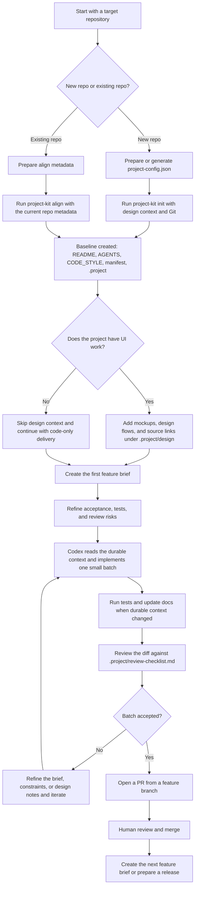

# Project Kit


Project Kit is a Codex skill and scaffold for `developer-led` software delivery.
It is designed for people who know how they want a system to be built, want Codex to implement inside that perimeter, and want reviewable artifacts instead of process theater.

This is not an Agile framework and it is not a vibe-coding starter.
The model is:

- `architecture-first`
- `feature briefs instead of backlog theater`
- `human-owned design context for UI work`
- `small implementation batches`
- `mandatory review gates`

## What It Scaffolds

Project Kit bootstraps a repository around three layers of context:

- `Durable context`
  What the software is, how it is shaped, and which constraints matter.
- `Design context`
  Human-owned mockups, annotations, flows, and canonical design sources for UI work.
- `Execution context`
  Small feature briefs and a review checklist that tell Codex what to implement next.

The default baseline is:

```text
README.md
AGENTS.md
CONTRIBUTING.md
CHANGELOG.md
CODE_STYLE.md
package.json | composer.json | project.json
project-name.code-workspace
.project/
  overview.md
  architecture.md
  constraints.md
  decisions.md
  review-checklist.md
  features/
    index.md
    feature-name.md
  design/
    README.md
    flows.md
    sources.md
    assets/
```

`design/` is optional and should exist only for UI work.

## Core Principles

- Humans own architecture, scope, UI/UX decisions, and acceptance.
- Codex helps with repository analysis, implementation, and controlled documentation updates.
- UI design is not delegated to AI. When design assets exist, Codex implements them rather than inventing a different interface.
- Every non-trivial batch should be small enough for human review.
- Stable constraints matter more than ceremonial process vocabulary.

## Recommended Workflow

### 1. Blueprint the system

Capture:

- the project goal;
- the system shape;
- trust boundaries;
- integrations;
- hard constraints;
- non-goals.

Those become:

- `.project/overview.md`
- `.project/architecture.md`
- `.project/constraints.md`

### 2. Add feature briefs

Each feature gets its own file under `.project/features/`.
A feature brief should capture:

- goal;
- user-visible behavior;
- in scope;
- out of scope;
- modules involved;
- design references;
- acceptance criteria;
- test expectations;
- risks and review focus.

### 3. Add design context for UI projects

When a project has UI, keep the design context human-owned and explicit under `.project/design/`.

Use:

- `assets/` for exported screens and annotated variants;
- `flows.md` for navigation, states, and multi-screen behavior;
- `sources.md` for Figma links or other canonical sources.

The default asset convention is:

- `screen-name.png`
- `screen-name.annotated.png`
- `screen-name.annotations.md` when numeric callouts need prose

### 4. Implement in small batches

Codex should work on one reviewable batch at a time, not on an entire application in a single prompt.
Each batch should be understandable in diff form.

### 5. Review before moving on

Use `.project/review-checklist.md` as the gate for every non-trivial change.
That review should cover:

- architecture alignment;
- feature alignment;
- simplicity and necessity;
- security;
- test coverage where needed;
- design fidelity when UI is involved.

## Use As A Skill

Project Kit is a normal Codex skill directory.
You can install it under the root your Codex setup already uses:

- `$HOME/.codex/skills/project-kit`
- `$HOME/.agents/skills/project-kit`
- `.agents/skills/project-kit` for repo-scoped use

Example:

```bash
mkdir -p "$HOME/.codex/skills"
ln -s "/absolute/path/to/project-kit" "$HOME/.codex/skills/project-kit"
```

Then use prompts like:

```text
Use $project-kit to init a new TypeScript backend for a billing API with explicit constraints and review gates.
```

```text
Use $project-kit to align this existing React repository and add design context for provided mockups.
```

## Standalone Scaffold

Use the CLI when you want the baseline quickly and you are comfortable refining the generated docs yourself.

```bash
node ./bin/project-kit.js init --target /absolute/path/to/repo --meta ./project-config.sample.json
```

For UI-heavy projects, add `--design-context` to scaffold `.project/design/`.

## Daily Feature Loop

After the repository is initialized or aligned, use the feature command instead of rerunning scaffold operations.

```bash
node ./bin/project-kit.js feature create --name "User authentication"
node ./bin/project-kit.js feature update --slug user-authentication --acceptance "Can sign in,Can sign out" --tests "Add auth controller tests"
node ./bin/project-kit.js feature list
```

This keeps the daily workflow narrow:

- `init` and `align` define the repository operating system;
- `feature create` starts the next implementation brief;
- `feature update` refines acceptance, tests, design references, or review focus;
- `feature list` shows the current brief inventory.

## End-to-End Demo

This example simulates a UI project named `acme-billing-web`, from scaffold to the first reviewed pull request.



Example metadata for the simulated project:

```json
{
    "projectName": "acme-billing-web",
    "description": "Billing portal for small teams with explicit architecture and review gates",
    "originalPromptEnglish": "Build a browser-first billing portal for small teams with explicit architecture, durable feature briefs, and review gates.",
    "primaryLanguage": "TypeScript",
    "stack": ["TypeScript", "React"],
    "features": ["User authentication", "Billing dashboard"],
    "designContext": true,
    "initGit": true
}
```

Example command sequence:

```bash
node ./bin/project-kit.js init --target /tmp/acme-billing-web --meta ./project-config.json
node ./bin/project-kit.js feature create --name "User authentication"
node ./bin/project-kit.js feature update --slug user-authentication --acceptance "Can sign in,Can sign out" --tests "Add auth form tests,Add auth session tests" --risks "Auth boundary,Session handling"
node ./bin/project-kit.js feature list
```

If the repository already exists, replace `init` with `align` and keep the same feature brief and review loop.

## Metadata Contract

`init` expects this metadata shape:

```json
{
    "projectName": "project-kit",
    "description": "Architecture-first baseline for developer-led Codex work",
    "originalPromptEnglish": "Create a disciplined Codex-ready baseline for a TypeScript and React project with feature briefs and review gates.",
    "primaryLanguage": "TypeScript",
    "stack": ["TypeScript", "React"],
    "features": ["User authentication", "Usage reporting"],
    "designContext": true,
    "initGit": true
}
```

Required fields:

- `projectName`
- `description`
- `primaryLanguage`
- `stack`

Optional fields:

- `features`
- `originalPromptEnglish`
- `designContext`
- `initGit`

When `init` runs without an existing `project-config.json`, the resolved metadata is written to `project-config.json` in the target repository so future runs can restart from it.
When the config is derived from a free-form request, store the full request translated into English under `originalPromptEnglish`.

## Development

```bash
npm test
```

The test suite covers the public CLI, automatic `project-config.json` loading, feature brief scaffolding, design context generation, and alignment behavior on existing repositories.

## Community

- [Contributing](./CONTRIBUTING.md)
- [Security](./SECURITY.md)
- [License](./LICENSE)
