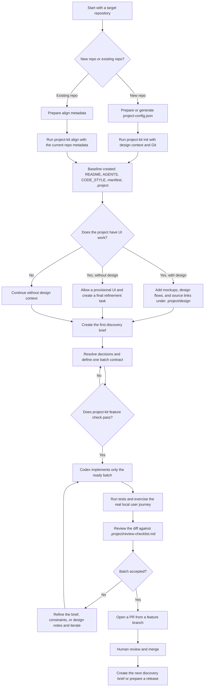

# Project Kit


Project Kit is a Codex skill and scaffold for `developer-led` software delivery.
It is designed for people who know how they want a system to be built, want Codex to implement inside that perimeter, and want reviewable artifacts instead of process theater.

This is not an Agile framework and it is not a vibe-coding starter.
The model is:

- `architecture-first`
- `just-in-time feature briefs with a readiness gate`
- `human-owned design context for UI work`
- `one risk-focused implementation batch at a time`
- `mandatory review gates`

## What It Scaffolds

Project Kit bootstraps a repository around three layers of context:

- `Durable context`
  What the software is, how it is shaped, and which constraints matter.
- `Design context`
  Human-owned mockups, annotations, flows, and canonical design sources for UI work.
- `Execution context`
  Ready feature briefs, explicit batch contracts, local verification, and a review checklist that tell Codex exactly what to implement next.

The default baseline is:

```text
README.md
AGENTS.md
CONTRIBUTING.md
CHANGELOG.md
CODE_STYLE.md
package.json | composer.json | project.json
project-name.code-workspace
.project/
  overview.md
  architecture.md
  constraints.md
  decisions.md
  review-checklist.md
  features/
    index.md
    feature-name.md
  design/
    README.md
    flows.md
    sources.md
    assets/
```

`design/` is optional and should exist only for UI work.

### Application project types

`init` can also apply an explicit application starter before it renders the durable Project Kit baseline.

The first bundled project type is `react-spa`, a TypeScript, React, and Vite single-page application with routing, theming, error boundaries, static error pages, shared controls, Sass styles, and a reproducible lockfile.
The starter intentionally loads the Inter typeface from Google Fonts at runtime, so generated projects should account for that external request in their privacy and Content Security Policy decisions.

Project types are opt-in and are never inferred from `stack`. This keeps React frameworks, component libraries, browser extensions, and existing applications from receiving an incompatible SPA layout. Application starters are available only during `init`; `align` remains documentation-first and never injects product code.

## Core Principles

- Humans own architecture, scope, final UI/UX direction, and acceptance.
- Codex helps with repository analysis, implementation, and controlled documentation updates.
- When design assets exist, Codex implements them rather than inventing a different interface. Without precise design, Codex may create a functional provisional UI for validation, followed by an explicit final UI refinement task.
- Every non-trivial batch should be small enough for human review.
- A green test suite is not enough: non-trivial changes also require the real local user journey to be exercised.
- Stable constraints matter more than ceremonial process vocabulary.

## Recommended Workflow

### 1. Blueprint the system

Capture:

- the project goal;
- the system shape;
- trust boundaries;
- integrations;
- hard constraints;
- non-goals.

Those become:

- `.project/overview.md`
- `.project/architecture.md`
- `.project/constraints.md`

### 2. Add feature briefs

Each feature gets its own file under `.project/features/`.
A feature brief should capture:

- readiness, user approval evidence, approved decisions, and open decisions;
- goal;
- user-visible behavior;
- in scope;
- out of scope;
- exactly one current implementation batch;
- modules involved;
- persistence, API, configuration/resource, and UI impact;
- design references;
- acceptance criteria;
- test expectations;
- local user-journey verification;
- required follow-up tasks;
- risks and review focus.

New briefs default to `discovery`. They become implementation-ready only when the user has approved the exact batch contract, that evidence is recorded, their status is `ready`, no blocking decisions remain, and `project-kit feature check` succeeds.

### 3. Add design context for UI projects

When a project has UI, keep the design context human-owned and explicit under `.project/design/`.

Use:

- `assets/` for exported screens and annotated variants;
- `flows.md` for navigation, states, and multi-screen behavior;
- `sources.md` for Figma links or other canonical sources.

The default asset convention is:

- `screen-name.png`
- `screen-name.annotated.png`
- `screen-name.annotations.md` when numeric callouts need prose

### 4. Make one batch ready

Resolve blocking decisions and define one concise change contract: the current batch, explicit non-goals, affected surfaces, acceptance, tests, local verification, and review risks. The agent may draft it, but only the user can approve the transition to `ready`. Apply the anti-overengineering gate here, before speculative work reaches the diff.

If the batch crosses persistence, backend, worker/runtime, UI, and operations, split it unless the cross-layer slice is required for one independently verifiable outcome.

### 5. Implement one ready batch

Codex should work on the one batch named by the ready brief, not on an entire application in a single prompt.
Each batch should be understandable in diff form.

### 6. Verify and review before moving on

Use `.project/review-checklist.md` as the gate for every non-trivial change.
That review should cover:

- architecture alignment;
- feature alignment;
- simplicity and necessity;
- security;
- test coverage where needed;
- the real local user journey;
- design fidelity when UI is involved.

## Use As A Skill

Project Kit is a normal Codex skill directory.
You can install it under the root your Codex setup already uses:

- `$HOME/.codex/skills/project-kit`
- `$HOME/.agents/skills/project-kit`
- `.agents/skills/project-kit` for repo-scoped use

Example:

```bash
mkdir -p "$HOME/.codex/skills"
ln -s "/absolute/path/to/project-kit" "$HOME/.codex/skills/project-kit"
```

Then use prompts like:

```text
Use $project-kit to init a new TypeScript backend for a billing API with explicit constraints and review gates.
```

```text
Use $project-kit to align this existing React repository and add design context for provided mockups.
```

## Standalone Scaffold

Use the CLI when you want the baseline quickly and you are comfortable refining the generated docs yourself.

```bash
node ./bin/project-kit.js init --target /absolute/path/to/repo --meta ./project-config.sample.json
```

For UI-heavy projects, add `--design-context` to scaffold `.project/design/`.
The scaffold writes dependency manifests and lockfiles but does not install dependencies automatically.

## Daily Feature Loop

After the repository is initialized or aligned, use the feature command instead of rerunning scaffold operations.

```bash
node ./bin/project-kit.js feature create --name "User authentication"
node ./bin/project-kit.js feature update \
  --slug user-authentication \
  --status ready \
  --approval "User approved the session-boundary batch" \
  --open-decisions none \
  --problem "Users cannot start a session" \
  --outcome "Users can sign in safely" \
  --behavior "Users can sign in,Invalid credentials are rejected" \
  --in-scope "Session creation,Sign-in form" \
  --out-of-scope "Password recovery" \
  --batch "Implement the session boundary" \
  --modules "Authentication API,Sign-in UI" \
  --persistence-impact "None" \
  --api-impact "Add the session endpoint" \
  --config-impact "None" \
  --ui-impact "Add the sign-in form" \
  --ui-maturity final \
  --acceptance "Can sign in,Can sign out" \
  --tests "Add auth controller tests" \
  --verification "Start locally and complete sign-in" \
  --risks "Authentication boundary"
node ./bin/project-kit.js feature check --slug user-authentication
node ./bin/project-kit.js feature list
```

This keeps the daily workflow narrow:

- `init` and `align` define the repository operating system;
- `feature create` starts the next discovery brief;
- `feature update` resolves decisions and defines one current batch and its change contract;
- `feature check` blocks implementation until the brief is genuinely ready;
- `feature list` shows the current brief inventory and each readiness status.

## End-to-End Demo

This example simulates a UI project named `acme-billing-web`, from scaffold to the first reviewed pull request.



Example metadata for the simulated project:

```json
{
    "projectType": "react-spa",
    "projectName": "acme-billing-web",
    "description": "Billing portal for small teams with explicit architecture and review gates",
    "originalPromptEnglish": "Build a browser-first billing portal for small teams with explicit architecture, durable feature briefs, and review gates.",
    "primaryLanguage": "TypeScript",
    "stack": ["TypeScript", "React"],
    "features": ["User authentication", "Billing dashboard"],
    "designContext": true,
    "initGit": true
}
```

Example command sequence:

```bash
node ./bin/project-kit.js init --target /tmp/acme-billing-web --meta ./project-config.json
node ./bin/project-kit.js feature create --name "User authentication"
node ./bin/project-kit.js feature update \
  --slug user-authentication \
  --status ready \
  --approval "User approved the session-boundary batch" \
  --open-decisions none \
  --problem "Users cannot start a session" \
  --outcome "Users can sign in safely" \
  --behavior "Users can sign in,Invalid credentials are rejected" \
  --in-scope "Session creation,Sign-in form" \
  --out-of-scope "Password recovery" \
  --batch "Implement the session boundary" \
  --modules "Authentication API,Sign-in UI" \
  --persistence-impact "None" \
  --api-impact "Add the session endpoint" \
  --config-impact "None" \
  --ui-impact "Add the final sign-in form" \
  --ui-maturity final \
  --acceptance "Can sign in,Can sign out" \
  --tests "Add auth form tests,Add auth session tests" \
  --verification "Start locally and complete sign-in" \
  --risks "Auth boundary,Session handling"
node ./bin/project-kit.js feature check --slug user-authentication
node ./bin/project-kit.js feature list
```

If the repository already exists, replace `init` with `align` and keep the same feature brief and review loop.

## Metadata Contract

`init` expects this metadata shape:

```json
{
    "projectType": "react-spa",
    "projectName": "project-kit",
    "description": "Architecture-first baseline for developer-led Codex work",
    "originalPromptEnglish": "Create a disciplined Codex-ready baseline for a TypeScript and React project with feature briefs and review gates.",
    "primaryLanguage": "TypeScript",
    "stack": ["TypeScript", "React"],
    "features": ["User authentication", "Usage reporting"],
    "designContext": true,
    "initGit": true
}
```

Required fields:

- `projectName`
- `description`
- `primaryLanguage`
- `stack`

Optional fields:

- `projectType`: currently `react-spa`; applied only during `init`
- `features`
- `originalPromptEnglish`
- `designContext`
- `initGit`

When `init` runs without an existing `project-config.json`, the resolved metadata is written to `project-config.json` in the target repository so future runs can restart from it.
When the config is derived from a free-form request, store the full request translated into English under `originalPromptEnglish`.
If `projectType` is present, application-file collisions stop `init` before the Project Kit baseline is written. Use `--force` only when replacing those files is intentional.

## Development

```bash
npm test
```

The test suite covers the public CLI, automatic `project-config.json` loading, React SPA generation and collision handling, feature brief scaffolding, design context generation, and alignment behavior on existing repositories.

## Community

- [Contributing](./CONTRIBUTING.md)
- [Security](./SECURITY.md)
- [License](./LICENSE)
